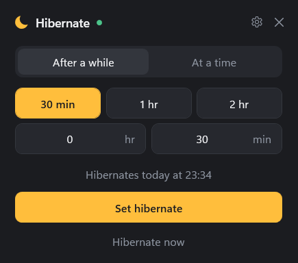
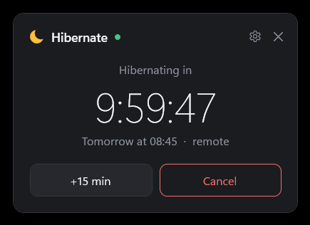

# Hibernate Scheduler

A small Windows tray app that hibernates your laptop at a time you choose. Set one hibernate, watch it count down, cancel it if you change your mind. You can also trigger it from your phone through your own OneDrive, with no third-party service and no open ports.

<p align="center">
  
  &nbsp;
  
</p>

## Features

- **One hibernate at a time.** Pick "After a while" (30 min, 1 hr, 2 hr or any hours and minutes) or "At a time" (for example 22:30).
- **Easy to change your mind.** Add 15 minutes or cancel at any point before it happens.
- **Warning before it happens.** A small always-on-top card gives you 60 seconds (configurable) with **Now**, **+15 min** and **Cancel**. It never takes keyboard focus, so you can't press a button by accident while typing.
- **Sleep-safe.** If the time passes while the laptop is already asleep or off, the hibernate is cleared rather than run when you wake it.
- **Remote trigger through OneDrive (optional).** Create a folder named `hibernate 30` from the OneDrive app on your phone and the laptop does it. The result is written back to a `status.txt` you can read on your phone.
- **Lives in the tray.** Left-click the moon icon to open, right-click for quick actions. Optionally starts with Windows.

## Requirements

- Windows 10 or 11 (64-bit)
- Hibernate enabled on the machine (see [Troubleshooting](#troubleshooting))
- For the remote trigger: OneDrive installed and signed in on the laptop, and the OneDrive app on your phone

No .NET install is needed; the release build is self-contained.

## Install

1. Go to the [latest release](../../releases/latest).
2. Download either:
   - `HibernateScheduler.exe` to run it directly, or
   - `HibernateScheduler-<version>-win-x64.zip` and extract it anywhere.
3. Run `HibernateScheduler.exe`. Windows SmartScreen may warn that the app is unrecognised because it isn't code-signed; choose **More info → Run anyway**.
4. Optional: open Settings (gear icon) and turn on **Start with Windows**.

A good permanent home is `%LocalAppData%\Programs\HibernateScheduler\`. To add it to Start, create a shortcut to the exe in `%AppData%\Microsoft\Windows\Start Menu\Programs\`, then right-click it in Start and choose **Pin to Start**.

## Using it

1. Click the moon icon in the system tray.
2. Choose **After a while** or **At a time** and set the duration or time. The line under the inputs shows exactly when it will happen.
3. Click **Set hibernate** (or press Enter).
4. While it's pending, the window shows a live countdown with **+15 min** and **Cancel**.
5. When the time comes, the warning card appears for 60 seconds, then the laptop hibernates.

Closing the window hides it to the tray. To quit completely, right-click the tray icon and choose **Exit**.

## Remote trigger (OneDrive)

The remote trigger lets you hibernate the laptop from anywhere, using a folder in your own OneDrive as the message channel.

### Set up

1. Open the app, click the gear icon and turn on **Remote trigger via OneDrive**.
2. The app creates `OneDrive\HibernateRemote\<computer name>\` and puts two files in it:
   - `How to use.txt`: these instructions, written to be read on a phone.
   - `status.txt`: the laptop's latest reply.
3. If you have more than one OneDrive (personal and work), the app uses your personal one by default. Use the pencil button to pick a different one.

### Send a command

1. On your phone, open the OneDrive app and go to **HibernateRemote → \<computer name\>**.
2. Tap **+**, then **Create folder**.
3. Name the folder with a command:

| Folder name | What happens |
| --- | --- |
| `hibernate` | 60-second warning on screen, then hibernate |
| `hibernate 30` | Hibernate in 30 minutes |
| `hibernate 2h` | Hibernate in 2 hours |
| `hibernate at 2300` | Hibernate at 23:00 (folder names can't contain `:`) |
| `cancel` | Cancel the pending hibernate or a running countdown |
| `status` | Just refresh `status.txt` |

4. Within a minute or so the folder disappears; that means the laptop has read it.
5. Open `status.txt` to see the result, for example:

```
LAPTOP is awake.
Hibernating tomorrow at 08:45.
Battery 100%, plugged in.
Last: Set from remote.
```

### How it works and why it's safe

- The app checks the folder every 3 seconds. When it finds a new folder (or file), it reads the name as a command, deletes it and writes `status.txt`.
- **No third-party service.** Commands travel only through your own OneDrive.
- **Nothing listens on the network.** The app only reads a local folder, so there's no port or endpoint anyone could reach.
- **Very limited commands.** The only possible actions are the six above. Folder names are never executed or opened.
- **Stale commands are ignored.** Anything older than 10 minutes, or created while the laptop was asleep, is discarded, so an old `hibernate` can't fire when you next open the laptop.
- Anyone who can create folders in that OneDrive folder can hibernate the laptop, so don't share it.

## Settings

| Setting | Default | Notes |
| --- | --- | --- |
| Start with Windows | Off | Adds a per-user entry under `HKCU\...\Run`; starts in the tray |
| Warning before hibernating | 60 s | 0 skips the warning |
| Remote trigger via OneDrive | Off | See above |

Settings are stored in `%AppData%\HibernateScheduler\settings.json`. Delete that file to reset everything.

## Troubleshooting

**"Hibernate is turned off on this machine."** Hibernate is disabled. Open an admin terminal and run:

```powershell
powercfg /hibernate on
```

Run `powercfg /a` to see which sleep states your machine supports. On managed (work) laptops, IT policy may block this.

**Can it wake the laptop remotely?** No. While hibernating, the laptop is effectively off, so nothing can receive a command. Wake-on-LAN from hibernate only works on some hardware, usually wired Ethernet with BIOS support.

**A remote command did nothing.** Check that the laptop is awake, the app is running (moon in the tray), and OneDrive is syncing (not paused). Sync delay is usually seconds but can be a minute or two.

**The window is behind other windows.** Click the tray icon; the window comes to the front near the tray.

## Build from source

Requires the [.NET 8 SDK](https://dotnet.microsoft.com/download/dotnet/8.0).

```powershell
git clone https://github.com/damola-m/hibernate-scheduler.git
cd hibernate-scheduler
dotnet build src/HibernateScheduler -c Release
```

To build the self-contained single exe and install it to `%LocalAppData%\Programs\HibernateScheduler`:

```powershell
.\publish.ps1
```

### Project layout

```
src/HibernateScheduler/
  App.xaml(.cs)            startup, single instance, tray icon, shared styles
  MainWindow.xaml(.cs)     set / countdown / settings views
  WarningWindow.xaml(.cs)  the 60-second warning card
  HibernateController.cs   the pending hibernate, clock and remote command handling
  OneDriveRemote.cs        watches the OneDrive folder, writes status.txt
  AppSettings.cs           settings.json
  PowerControl.cs          hibernate call and start-with-Windows entry
  NativeChrome.cs          rounded corners and border from Windows
  AppIcon.cs, app.ico      the moon icon
```

### Releases

Releases are built by GitHub Actions. Pushing a tag such as `v1.2.0` builds the self-contained exe, zips it and publishes a GitHub release with both files attached.

## Contributing

Contributions are welcome. Please read [CONTRIBUTING.md](CONTRIBUTING.md) first. All changes go through a pull request and need a review from the maintainer before they can be merged.

To report a security problem, see [SECURITY.md](SECURITY.md).

## Licence

[MIT](LICENSE) © noissaPStudio
